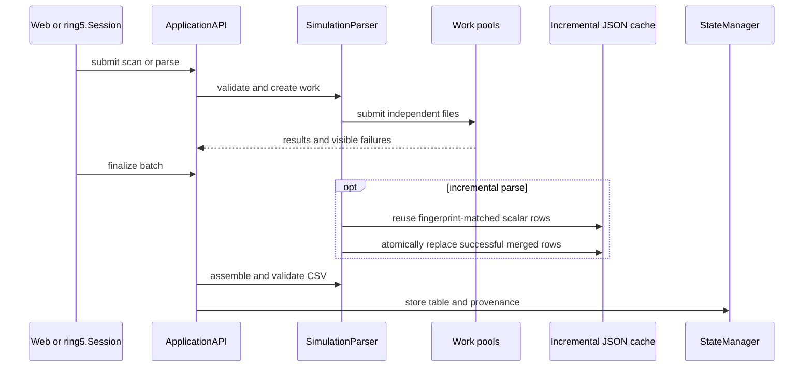
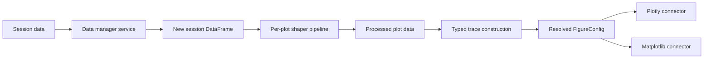

# Data flow

## Parse and load

<!--
`uman~ring5.ingestion.parse-output-provenance.documentation~1`

Covers:
- req~ring5.ingestion.parse-output-provenance~1

`uman~ring5.quality.async-ownership.documentation~1`

Covers:
- req~ring5.quality.async-ownership~1

-->

Scan and parse work follows submit/finalize contracts. Submission returns owned futures; finalization
aggregates results and preserves per-file failures. Do not hide asynchronous work inside a component
or fabricate a placeholder value after a parser error.

`BackgroundJobService` observes those existing futures without duplicating their parser payloads.
It also owns a two-worker executor for explicitly submitted transformations and exports. Its
thread-safe records are bounded, exposed as immutable snapshots, and scoped to one
`ApplicationAPI` session. Cancellation distinguishes a request from terminal cancellation, and a
retry is offered only when the service owns a factory for the complete operation. The web job
center depends on the application facade and these core models; core does not import Streamlit.
Callable jobs record their actual execution start. Externally cancelled futures yield a cancelled
job, including partial cancellations, rather than a successful completion. Queued work cancelled
before execution has no start timestamp.

Incremental submission first discovers the same bounded file set and hashes complete input
contents. It filters the normal strategy work items to new or changed paths; it does not introduce
a synchronous parser or bypass the shared worker pool. Finalization uses each worker result's
internal source provenance to replace exactly that file's finalized row, retains unchanged rows,
and omits deleted paths. The JSON cache contains strings and fingerprints rather than pickles or
live parser objects. The final CSV and cache are each replaced atomically, and the cache is written
only after every changed worker succeeds.

`Session.load` and the CSV pool converge on `ApplicationAPI.load_data`, which stores a DataFrame in
the session repository. The generic CSV contract requires a header and rows; individual services
validate operation-specific columns and types.

The review-before-load path first creates an immutable `ImportPreview` in the core service. Format
detection, corrections, inference, and row classification do not touch session state. Loading
re-reads the bounded source, verifies its SHA-256 fingerprint and the complete preview result, then
stores only accepted rows through `ApplicationAPI.load_import_preview`.

Browser uploads cross a separate `BrowserUploadService` trust boundary. It validates extension,
declared media type, byte size, and parse structure before staging content below the session's
temporary directory. CSV stays delimited text; flat JSON and the first visible Excel worksheet are
normalized to bounded UTF-8 CSV and then enter the normal `ImportPreview` path. A portfolio is
migrated and summarized without state mutation, re-fingerprinted on confirmation, and only then
passed to `StateManager.restore_session`.

Remote sources enter that same boundary through `RemoteSourceService`. Its HTTP, system-SSH, and
S3-compatible adapters share a deny-by-default `RemoteSourcePolicy`, DNS/private-address checks,
bounded reads, sanitized errors, and query-free display provenance. HTTP redirects are
re-authorized; credentialed requests do not redirect. The application facade passes only fetched
bytes and a safe filename into `BrowserUploadService`, so remote transports cannot bypass import
review or portfolio confirmation.

## Transform and plot

Manager services and shapers copy their inputs. A confirmed manager result replaces the workspace
table; a shaper result belongs to its plot. The render controller pairs processed data, persisted
configuration, rendering engine, and a cache key before reusing a figure.

## Save and restore

Portfolio saving serializes the active table, plots, plot configuration, pipelines, parser
provenance, and history. `PortfolioMigrator` upgrades older JSON before
`StateManager.restore_session` restores items and returns a `RestoreReport`. Preparation runs
outside the state lock; publication rejects any intervening state-manager write, including
unselected dataset results. Preview invalidation separately tracks changes to the selected source.

Headless replay loads the same portfolio, renders each restored plot through the selected connector,
and exports it. A partial restore remains visible; the CLI refuses to upgrade a portfolio when
re-saving would discard skipped content.

Local configuration imports hold a reentrant thread lock and a portable operating-system file
lock across logical-name lookup, allocation, and publication. Parse runtimes retain an exclusive
file lock for their lifetime; startup cleanup removes only unlocked orphan workspaces. Native
Windows uses `msvcrt`, while Unix uses `flock`. These advisory locks coordinate cooperating
processes on local filesystems.

Mean and Normalize cache full retained-frame identity, including uncertainties, column labels,
dtypes, index and semantic attributes. CSV data and metadata caches share precise file identity
(device, inode, size and nanosecond modification/change times); a file changed during a read is
rejected rather than published under an earlier signature. Metadata row counts parse CSV records
so quoted newlines and blank records are handled consistently.

Data-manager previews retain the exact source version, stable source signature, and a defensive
copy of the options used for computation. Capture `api.preview_input_signature()` before doing
numerical work; pass that token and `operation_config` to `api.set_preview`. Computation runs
outside the state transaction. `preview_matches` checks whether confirmation remains available,
and `confirm_preview` compares source and options and publishes the result in one transaction.
Legacy previews retain display support and require a fresh guarded preview before confirmation.

`api.report_input_signature` captures selected plot configuration, pipelines, per-plot figure
configuration, source and processed frames, global settings, source revisions, and provenance.
Hashing runs after taking defensive snapshots. Repeated reads produce the same signature;
changes to any retained scientific input invalidate derived report content. Saved bundle caches
use `api.portfolio_bundle_signature`, which verifies and hashes exact portfolio and optional
snapshot bytes. Remote `.ring5-bundle` files enter the same verified browser-upload boundary as
local uploads.

State-change callbacks run after publication releases its lock. A callback supplied inside an
explicit state transaction is rejected before changing data; schedule it after the transaction
exits. Data and preview repositories, and public `Table` handles, own nested Python object cells
as well as ordinary numeric arrays, so mutation through a caller's frame cannot change reviewed
or historical values.

Portfolio restore prepares a fresh repository outside the shared state lock, including CSV
parsing and injected plot deserializers. Exceptions during preparation retain the current
repository. Per-item restore warnings remain best-effort. Publication replaces the workspace in
one transaction and rejects a source change that occurs during preparation. Restore cannot run
inside an existing state transaction, where foreign deserializers could otherwise inherit its
lock. Other workspace settings are replaced when the candidate is published.
