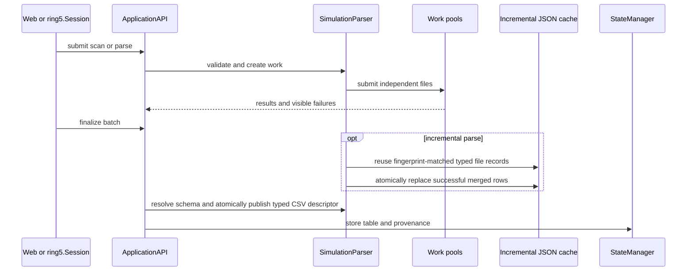
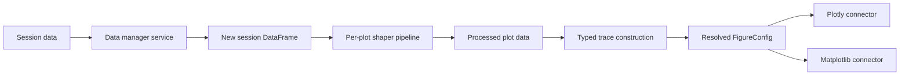

# Data flow

## Parse and load

<!--
`uman~ring5.ingestion.parse-output-provenance.documentation~1`

Covers:
- req~ring5.ingestion.parse-output-provenance~1

`uman~ring5.quality.async-ownership.documentation~1`

Covers:
- req~ring5.quality.async-ownership~1

-->

Scan and parse work follows submit/finalize contracts. Submission returns owned futures; finalization
aggregates results and preserves per-file failures. Do not hide asynchronous work inside a component
or fabricate a placeholder value after a parser error.

`BackgroundJobService` observes those existing futures without duplicating their parser payloads.
It also owns a two-worker executor for explicitly submitted transformations and exports. Its
thread-safe records are bounded, exposed as immutable snapshots, and scoped to one
`ApplicationAPI` session. Cancellation distinguishes a request from terminal cancellation, and a
retry is offered only when the service owns a factory for the complete operation. The web job
center depends on the application facade and these core models; core does not import Streamlit.
Callable jobs record their actual execution start. Externally cancelled futures yield a cancelled
job, including partial cancellations, rather than a successful completion. Queued work cancelled
before execution has no start timestamp.

Incremental submission first discovers the same bounded file set and hashes complete input
contents. It filters the normal strategy work items to new or changed paths; it does not introduce
a synchronous parser or bypass the shared worker pool. Finalization uses each immutable worker result's
explicit source path to replace exactly that file's finalized row, retains unchanged rows,
and omits deleted paths. The current JSON cache contains typed file records and fingerprints rather than pickles or
live accumulator objects. The final CSV and cache are each replaced atomically, and the cache is written
only after every changed worker succeeds.

`Session.load(ParseResult)` passes the explicit descriptor and actual request context to
`ApplicationAPI.load_data`. `Session.load(str)` and CSV pool imports use genuine CSV inference at
that same ingestion owner. Successful publication commits the exact frame and immutable loaded
origin together. The descriptor path is never a lookup key for recovering schema or request state.
The session repository stores the owned DataFrame; individual services validate operation-specific
columns and types. Typed parser admission verifies schema and digest, while genuine CSV ingestion
retains its inference/null policy.

The review-before-load path first creates an immutable `ImportPreview` in the core service. Format
detection, corrections, inference, and row classification do not touch session state. Loading
re-reads the bounded source, verifies its SHA-256 fingerprint and the complete preview result, then
stores only accepted rows through `ApplicationAPI.load_import_preview`.

Browser uploads cross a separate `BrowserUploadService` trust boundary. It validates extension,
declared media type, byte size, and parse structure before staging content below the session's
temporary directory. CSV stays delimited text; flat JSON and the first visible Excel worksheet are
normalized to bounded UTF-8 CSV and then enter the normal `ImportPreview` path. A portfolio is
validated and summarized without state mutation, re-fingerprinted on confirmation, and only then
passed to `StateManager.restore_session`.

Remote sources enter that same boundary through `RemoteSourceService`. Its HTTP, system-SSH, and
S3-compatible adapters share a deny-by-default `RemoteSourcePolicy`, DNS/private-address checks,
bounded reads, sanitized errors, and query-free display provenance. HTTP redirects are
re-authorized; credentialed requests do not redirect. The application facade passes only fetched
bytes and a safe filename into `BrowserUploadService`, so remote transports cannot bypass import
review or portfolio confirmation.

## Transform and plot

`Session.render`, reports, and dashboards call `prepare_figure` once per plot. Its
`PreparedFigure` owns effective semantic/accessibility defaults, neutral trace output and one
resolved `FigureConfig`. Native builders consume that result without constructing the other
engine's figure or resolving styling again. Matplotlib standalone figures and dashboard panels
share `draw_matplotlib_axes`; the panel compositor owns its outer margins and legend domains.
Trace legend roles stay independent of Y-axis roles and numbered annotation styling.

Native builders return one engine result containing its actual source associations. Original names
remain stable for styles, order and groups; `legend_labels` supplies late display text. Copies and
dashboard assembly transfer associations explicitly to destination traces/artists. Connectors
preflight the whole owned root before reapply, while exports consume the completed native figure.

Public single-plot rendering publishes effective configuration, neutral output, resolved style,
native artifact and reuse key together through `BasePlot.publish_render_artifact` after a successful
build. Publication relinquishes its Matplotlib manager without clearing artist content; callers
retain usable figures. `invalidate_figure` detaches the owned generation and clears its render
references without claiming a manager later registered by a borrower.
PlotRepository compares object identity when disposing removed or replaced plots, including restore
publication and rejected-candidate cleanup. Duplication detaches artifacts before copying domain
state; transient facet views never acquire ownership of the source plot's artifacts.

Workspace storage detaches the per-plot source contributor declaration when it owns primary,
processed or named revision data. Manager previews and later revisions therefore cannot inherit a
finalized plot's claim after values or rows change. Other scientific metadata remains intact.
Finalized plot source/output pairs retain their own validated contributor relation independently.

Manager services and shapers copy their inputs. A confirmed manager result replaces the workspace
table; a shaper result belongs to its plot. The render controller pairs processed data, persisted
configuration, rendering engine, and a cache key before reusing a figure.

## Save and restore

Portfolio saving serializes the active table, plots, plot configuration, pipelines, parser
provenance, and history. `validate_portfolio_schema` rejects unsupported schemas before
`StateManager.restore_session` restores items and returns a `RestoreReport`. Preparation runs
outside the state lock; publication rejects any intervening state-manager write, including
unselected dataset results. Preview invalidation separately tracks changes to the selected source.

Headless replay loads the same portfolio, renders each restored plot through the selected connector,
and exports it. A partial restore remains visible through `RestoreReport`.

Local configuration imports hold a reentrant thread lock and a Linux `flock` lock across
logical-name lookup, allocation, and publication. Parse runtimes retain an exclusive file lock for
their lifetime; startup cleanup removes only unlocked orphan workspaces. These advisory locks
coordinate cooperating processes on local filesystems.

Mean and Normalize cache full retained-frame identity, including uncertainties, column labels,
dtypes, index and semantic attributes. `core.common.content_identity.frame_signature` owns this
typed identity for transformation caches, rendering, named-dataset revisions, previews, reports,
and reusable snapshots. `content_signature` composes operation parameters and figure configuration
without stringifying unsupported values. Optimization caches bypass unsupported or cyclic inputs;
revision and snapshot publication reject them before changing retained state or files.
`TypedTableCodec` is the single exact frame serializer for portfolios, plot source and processed
frames, and reusable snapshots. It validates current typed payloads and rejects inexact decoding;
CSV is an external interchange format, not an internal persistence representation.

Figure reuse includes every persisted configuration field, including axis ranges and legend
positions, plus its rendering engine. Transient widgets and browser events live outside that
configuration. CSV data and metadata caches share precise file identity
(device, inode, size and nanosecond modification/change times); a file changed during a read is
rejected rather than published under an earlier signature. Metadata row counts parse CSV records
so quoted newlines and blank records are handled consistently.

Data-manager previews retain one owned result and its required input and option context. Capture
`api.capture_preview_inputs()` before numerical work and pass those identities with
`operation_config` to `api.set_preview`. Active-source identities include their version and content
signature. For named comparisons, pass the ordered dataset names to capture their workspace
generation, revision and monotonic per-dataset mutation identities. A source changed and undone
also invalidates work captured before that change. Generation changes across reset and restore, so reused names
or revision numbers cannot authorize an earlier computation.

Computation runs outside the state transaction. Publication rechecks captured identities, and
`preview_matches` checks the current sources and options. Getters withhold stale results.
`confirm_preview` atomically validates and applies active-source transformation results; named
comparison results remain display-only. Changing either compared dataset or its controls
invalidates the result, while unrelated active selections leave named comparisons current.

`api.report_input_signature` captures selected plot configuration, pipelines, per-plot figure
configuration, source and processed frames, global settings, source revisions, and provenance.
Hashing runs after taking defensive snapshots. Repeated reads produce the same signature;
changes to any retained scientific input invalidate derived report content. Saved bundle caches
use `api.portfolio_bundle_signature`, which verifies and hashes exact portfolio and optional
snapshot bytes. Remote `.ring5-bundle` files enter the same verified browser-upload boundary as
local uploads.

State-change callbacks run after publication releases its lock. A callback supplied inside an
explicit state transaction is rejected before changing data; schedule it after the transaction
exits. Data and preview repositories, and public `Table` handles, own nested Python object cells
as well as ordinary numeric arrays, so mutation through a caller's frame cannot change reviewed
or historical values.

Portfolio restore prepares a fresh repository outside the shared state lock, including CSV
parsing and injected plot deserializers. Exceptions during preparation retain the current
repository. Per-item restore warnings remain best-effort. Publication replaces the workspace in
one transaction and rejects a source change that occurs during preparation. Restore cannot run
inside an existing state transaction, where foreign deserializers could otherwise inherit its
lock. Other workspace settings are replaced when the candidate is published.
