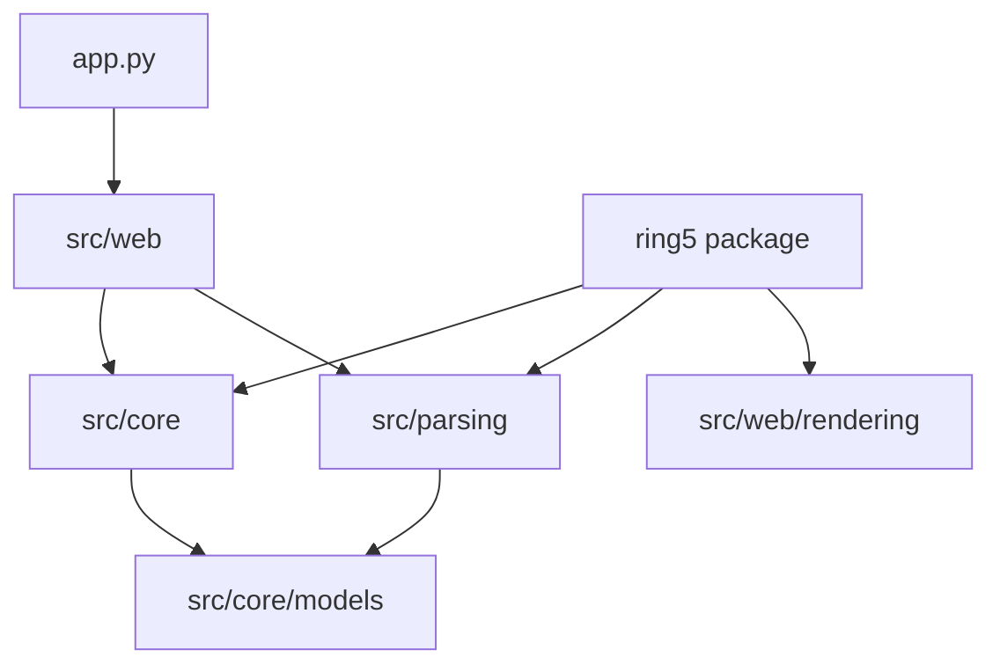

# Architecture overview

RING-5 has two composition roots and a one-way dependency structure. `app.py` builds a Streamlit
workspace; `ring5/` builds the supported headless workflow. Both compose parsing, core services, and
rendering without moving UI dependencies into the domain.

## Ownership

| Area | Owns | Does not own |
| --- | --- | --- |
| `src/parsing/` | Simulator discovery, variable scanning, parser strategies, CSV assembly | Streamlit state or plot rendering |
| `src/core/models/` | Cross-boundary dataclasses, typed mappings, protocols, visualization configuration | Service orchestration or UI widgets |
| `src/core/services/` | Data operations, shaper execution, persistent application data, portfolio validation | Streamlit rendering |
| `src/core/state/` | Repository-backed workspace state | UI-only widget state |
| `src/web/components/` | Streamlit widgets and visual output | Domain decisions |
| `src/web/controllers/` | UI orchestration across components and protocols | Persistent domain state implementations |
| `src/web/rendering/` | Plotly and Matplotlib connectors, figure configuration resolution, export bytes | Core business rules |
| `ring5/` | Stable Python facade, typed errors, CLI, headless composition | A promise that `src.*` is public API |

`src/core/application_api.py` is the facade used by the web application. It exposes services and
state operations without allowing components to construct repositories directly.

Internal imports name the module that owns each model, protocol or service. Core package
initializers contain package documentation; they do not eagerly load their submodules. The
`ring5` composition root exposes documented public values through lazy imports of their owning
modules.

## Visualization boundary

Plot implementations under `src/web/pages/ui/plotting/` map processed data into typed,
engine-independent traces. Rendering connectors translate those traces and the resolved figure
configuration into Plotly or Matplotlib figures. The public API uses the same builder and exporters,
so a headless Matplotlib render follows the application path below the Streamlit component.

## State boundary

`RepositoryStateManager` delegates to repositories for session data, parser configuration,
previews, plots, visualization state, and history. Web-only transient state remains behind
`UIStateManager`. Core and parsing code never access `st.session_state`.
Plot widget state uses exact `plot.<id>.widgets.*` ownership. Scoped widget resets, plot deletion,
and workspace restoration clear their corresponding namespaces through the same web state owner.
Parse progress identity and the last consumed result notice use `parse.*`. Completion is recorded
only after the facade consumes and loads the result; its receipt job ID gives the persistent
notice its container identity. Reusing a session CSV retains its path but consumes a new job.
Accepted submission or retry removes the prior notice, and workspace cleanup removes the namespace.

Plot artifacts use the native-free `PlotRenderState` owner. A repository replacement records each
removed identity and its exact binding generation. The outermost state transaction preserves
identities retained in the final workspace, detaches matching generations, then releases its locks
before invoking retirement callbacks. Restore candidates capture their generation on admission.
A newer independent publication or configuration-only edit survives stale cleanup. Cleanup failures remain visible after the
workspace and its version guards commit; every retired binding receives a cleanup attempt.

The bound payload is the single owner of effective configuration, native figure, preparation and
reuse identity. Detachment retains configuration-only state. Plot configuration reads return an
owned snapshot; callers assign a complete updated mapping to replace it and invalidate derived
artifacts. Copy hooks and resource cleanup execute outside the slot lock.

## Extension boundary

Registries select simulator backends, parsing strategies, plots, and shapers through exact canonical
identifiers. Replace all producers, consumers, fixtures and examples when a contract changes.
Reject retired identifiers rather than maintaining aliases or migrations.

Continue with [Data Flow]({{site.baseurl}}/developer-guide/architecture/data-flow/) and
[Layer Boundaries]({{site.baseurl}}/developer-guide/architecture/layer-boundaries/).
