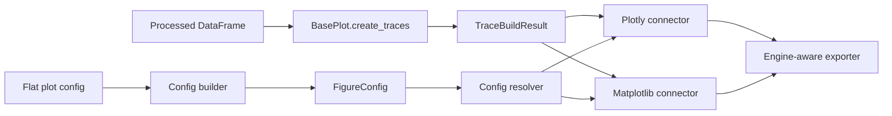

# Visualization subsystem

Visualization separates data mapping, styling, and backend translation.

## Engine-independent traces

<!--
`uman~ring5.render.engine-independent-traces.documentation~1`

Covers:
- req~ring5.render.engine-independent-traces~1

-->

Every registered plot type produces a typed `TraceBuildResult` before backend rendering. It carries
concrete trace families plus backend-neutral separators, shaded regions, rules, typed
`AnnotationConfig` entries, tick positions, and secondary-axis metadata. Histogram plots emit bar
traces with shared measured bucket geometry.

Bar renderers preserve row order, raw heights and uncertainty arrays. Grouped and overlay modes
start every bar at zero. Stacked mode accumulates all preceding visible rows at the same position
and on the same Y axis, including earlier rows of the current trace; relative mode separates
negative and nonnegative chains. Missing or nonfinite heights contribute no stack amount.
Plotly's grouped bars require an explicit zero base to prevent its implicit accumulation of
duplicate positions. Scientific conformance tests check native mark geometry as well as emitted
trace arrays.

`src/web/rendering/figure_preparation.py::prepare_figure` owns effective semantic/accessibility
configuration, one trace callback, non-color encoding and relabeling, and one typed styling
build/resolve. It returns an owned `PreparedFigure` without constructing native figures.
Public `Session.render`, reports, dashboards, small multiples and the browser controller use
this preparation before the selected native builder. Composite results retain every real panel
preparation. Numbered
annotations carry their semantic legend role; the central resolver applies inherited font sizes.

Plot types live under `src/web/pages/ui/plotting/types/` because their configuration UI and current
composition are web-owned. They emit models from `src/core/models/visualization/` and do not create
backend marks directly.

`src/web/rendering/config_builder.py` maps persisted flat configuration into `FigureConfig`.
`src/core/services/visualization/config_resolver.py` replaces inheritance sentinels on a copy before
a connector runs. Plotly and Matplotlib connectors apply the same ordered styling contract; trace
renderers handle mark-specific translation.

Export bytes are produced by `src/web/rendering/figure_export.py` and shared by the download UI and
the `ring5` facade. Each plot publishes one `RenderArtifact` with its exact configuration,
preparation, engine, source rows and cache identity. The controller selects an engine before cache
lookup; chart display and downloads consume the same artifact without rebuilding. Configuration
reads return private snapshots; replace the complete mapping to change settings.

`PlotRenderState` atomically stores one bound generation or detached configuration. Repository
retirement detaches the captured generation and disposes outside workspace and slot locks. Native
Matplotlib publication relinquishes its manager once; later retirement preserves borrowed figure
content and managers registered by callers. Connectors remain stateless.

## Source appearance

`TraceConfig.opacity` is concrete and finite in `[0, 1]`. `SeriesStyleConfig.opacity=None` means
no incremental opacity update; explicit `0` and `1` remain meaningful. Editable flat plot mappings
omit inheritance and reject present `null`, booleans and strings. Typed style serialization retains
`None`. Named overrides precede positional
styles, which precede retained source opacity. Every channel uses intrinsic alpha × effective
source opacity × its declared family factor. Area fill uses factor `1`, Radar fill `0.45`, Violin's
inner box `0.8`, and Sankey links their explicit link factor. Explicit source and semantic Waterfall
colors precede palette fallbacks. Main-series recoloring affects only declared channels, preserving
independent outlines, fixed companion colors and semantic channels.

`_appearance.py` owns selection, whole-root preflight and native projection through the existing
source bindings and result outputs. Matplotlib builders declare intrinsic channels before writing
attenuation. Plotly uses native trace opacity where supported; Sankey declares normal and hover
colors explicitly. Heatmap annotations carry their source cell and intrinsic font color in layout
role bindings. Data-label ownership never depends on matching text or coordinates. Source-owned
labels and error bars attenuate with their source; category captions, axes, titles, legend fonts,
grids and general annotations remain independent. Legend swatches inspect actual final marks.

Unrelated styling preserves manual native appearance. An affected channel with an unknown native
edit fails preflight before any panel changes; an explicit new color replaces only its declared
channels. Advanced pre-styled contexts deliberately declare `unmanaged()` capability, preserving
scalar/array alpha and data-mapped colors for nonappearance operations. Color, opacity or new
source-label operations require a new known intrinsic context. Canonical builders always supply
complete creation-time channels.

Heatmap colorbars use the intrinsic colormap, including embedded alpha and masked/below/above-range
colors, independently of source opacity. The attenuated native map delegates exact mapping to its
intrinsic map. Manual exceptional-color mutations require a new explicit context; replacing a
native map is preserved for unrelated operations and blocks affected updates. Managed colorbars
support `extend='neither'`; affected advanced extensions fail preflight. Appearance updates that
would mutate a foreign colorbar also fail before any native change.
Colorbar callbacks retain only their actual native output leaf. Private export copies retain no
live source/binding callback references and cannot change the live figure while drawing or saving.

Parallel coordinates share a selected-opacity boundary: both engines require selected opacity `1`
and opaque selected colors/scales because native Plotly discards selected color alpha. Existing
brushes and unselected opacity remain independent, and unselected `0` retains every row path.
Legend background `bgalpha` retains its separate replacement semantics.

When adding a visual setting, update its model round trip, builder, UI, both connectors, and public
`FigureSpec` when it belongs to the supported scripting surface. See
[Add a Renderer]({{site.baseurl}}/developer-guide/extension-guides/adding-a-renderer/).
