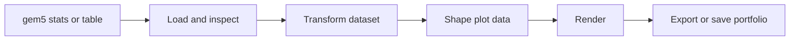

# RING-5 documentation

<!--
`uman~ring5.workspace.documentation-hub.documentation~2`

Covers:
- req~ring5.workspace.documentation-hub~2
-->

RING-5 turns gem5 statistics and tabular datasets into reproducible figures through a web
application, Python API, and CLI. Start with the result you need:

| Your task | Follow this guide | Result |
| --- | --- | --- |
| Try RING-5 without simulator files | [Explore the example portfolio](user-guide/getting-started/showcase/) | Inspect synthetic examples of every built-in plot type. |
| Learn the web application | [First analysis](user-guide/getting-started/first-analysis/) | Import a small supplied table, create a figure, and save the work. |
| Use your own results | [Load and parse data](user-guide/workflows/loading-data/) | Review a table or extract selected gem5 statistics. |
| Check a proposed configuration | [Compare configurations](user-guide/guides/compare-configurations/) | Align runs, assess regressions, and normalize comparisons. |
| Prepare a paper figure | [Publication output](user-guide/guides/publication-export/) | Set dimensions and labels, then export with the intended engine. |
| Write a repeatable script | [Python and CLI workflow](user-guide/workflows/scripting/) | Run a complete supported-API example and reproduce its outputs. |

[Install RING-5](user-guide/getting-started/installation/) before starting a local workflow.
The [User Guide](user-guide/) organizes all analysis tasks; [Reference](user-guide/reference/)
provides exact chart, transformation, settings, export, and troubleshooting details.

## How an analysis fits together

Dataset operations prepare shared data; each plot has its own shaping pipeline and figure settings.
Read [Core concepts](user-guide/getting-started/concepts/) when deciding which boundary to use.

## Develop RING-5

The [Developer Guide](developer-guide/) covers the architecture, contribution workflow, subsystems,
and extension points. Begin with [Development setup](developer-guide/development/setup/) and
[Architecture](developer-guide/architecture/).

Source code and issue tracking are on [GitHub](https://github.com/nikiitin/RING-5).
RING-5 is licensed under GPL-3.0-or-later.
